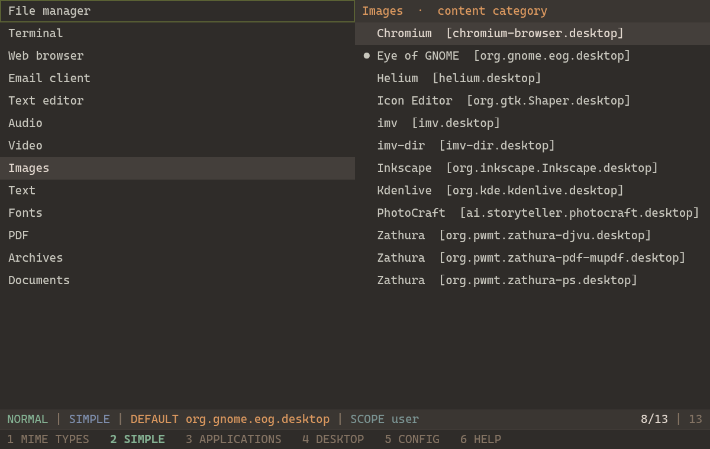
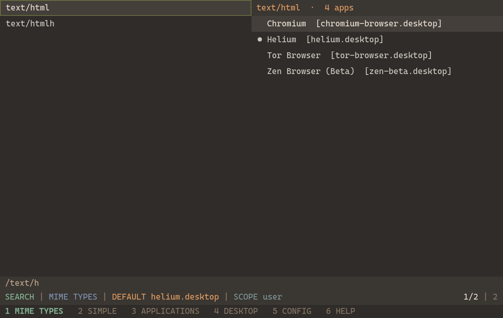
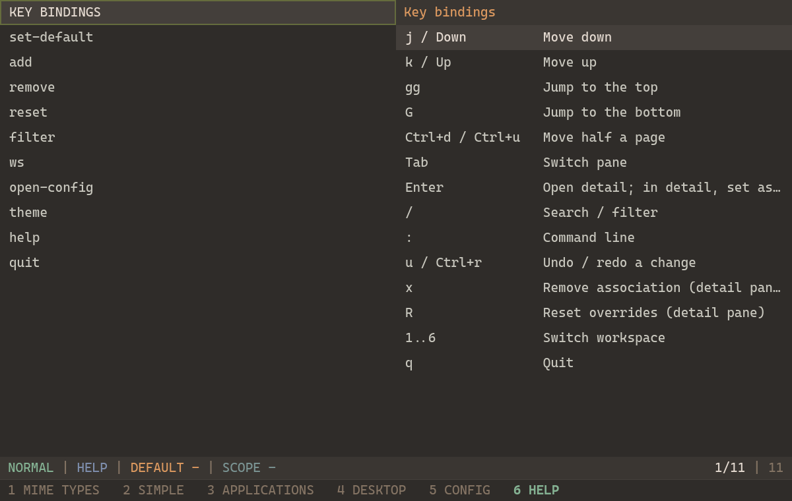
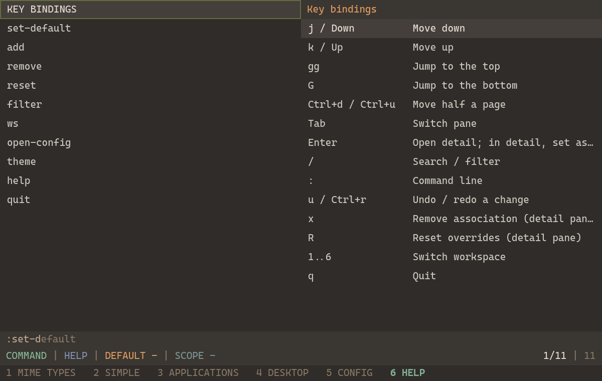

<p align="center">
  
</p>

<h1 align="center">mimo_manager</h1>

<p align="center">
  A keyboard-centric MIME type and default-application manager for Linux.<br>
  Browse the MIME database, set defaults for roles and categories, and apply changes to <code>mimeapps.list</code> instantly with Vim-style navigation.
</p>



## Features

- **Keyboard-first**: Modal, Vim-style navigation (j/k, gg/G, Tab, /, `:`, u/Ctrl+r).
- **MIME browser**: See all registered MIME types, their associations, and current defaults.
- **One-key workspaces**: `1` MIME TYPES, `2` SIMPLE, `3` APPLICATIONS, `4` DESKTOP, `5` CONFIG, `6` HELP.
- **SIMPLE mode**: Set defaults for common roles (File manager, Terminal, Web browser, Email, Text editor) and content categories (Audio, Video, Images, Text, Fonts, PDF, Archives, Documents).
- **Instant apply + undo**: `u` undoes the last change, `Ctrl+r` redoes.
- **Command palette with autocomplete**: `:set-default`, `:add`, `:remove`, `:reset`, `:filter`, `:ws`, `:open-config`, `:theme`, `:help`, `:quit` (Tab accepts ghost).
- **Themes**: Melange Dark (default), Gruvbox Dark, Nord, Catppuccin Mocha, Tokyo Night. Switch live with `:theme <NAME>` or set `theme` in the config.
- **Melange Dark aesthetic**: Compact modeline, square UI, mouse optional.

## Showcase

| MIME types with associations | HELP with key bindings | Command autocomplete |
|---|---|---|
|  |  |  |

## Installation

### NixOS (flake)

Add `mimo_manager` to your flake inputs:

```nix
inputs = {
  nixpkgs.url = "github:NixOS/nixpkgs/nixos-unstable";
  mimo_manager.url = "github:ex-jandal/mimo-manager";
  mimo_manager.inputs.nixpkgs.follows = "nixpkgs";
};
```

Then include the package or home-manager module. For system-wide:

```nix
environment.systemPackages = [ inputs.mimo_manager.packages.${system}.mimo_manager ];
```

### Home Manager

```nix
homeManagerModules.default = inputs.mimo_manager.homeManagerModules.default;

# in home-manager config:
programs.mimo_manager.enable = true;
# optional:
programs.mimo_manager.settings = {
  confirm_destructive = true;
  theme = "MELANGE DARK";
  modeline = {
    status = true;
  };
};
```

A `.desktop` file (`dev.mimo_manager.MimoManager.desktop`) is installed with the package, so it will appear in your launcher.

## Usage

Launch `mimo_manager` from a terminal or your application launcher. Keys:

- `1-6` switch workspaces
- `j/k`, `↑/↓`, `gg`, `G`, `Ctrl+d`, `Ctrl+u` navigate
- `Enter` open detail; `Tab` toggle focus
- `/` filter; `:` command palette; `x` remove; `R` reset
- `u` undo, `Ctrl+r` redo, `q` quit

Type `:help` to see all commands and key bindings.

## Configuration

Configuration is stored at `$XDG_CONFIG_HOME/mimo_manager/config.toml`. When using the Home Manager module with `settings`, it is generated for you. The app uses sensible defaults if the file is missing or empty.

```toml
theme = "MELANGE DARK"   # MELANGE DARK, GRUVBOX DARK, NORD, CATPPUCCIN MOCHA, TOKYO NIGHT
confirm_destructive = true

[modeline]
mode = true
workspace = true
selection = true
count = true
default = true
scope = true
status = true
theme = false
```

Change the theme at runtime with `:theme <NAME>` (session only; update the config to make it permanent).

## License

MIT OR Apache-2.0
